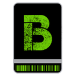

# LEDGER — Blacksite Network

**R.E.A.P.E.R. Divers independent contractor economy**  
*Every deal has a trail. The Broker is listening.*

LEDGER is a full-featured fictional economy Discord bot, built for a private military contractor-themed Helldivers 2 community. It runs locally or as a persistent Railway Discord worker. It uses **free, offline Tesseract OCR**, not an OpenAI API.

> **NEW: BLACKSITE OCR & DISPATCH POLISH** — Contract IDs (`BMC-000123` + numeric `123`) and mentor request IDs (`MTR-000123` + numeric `123`) are prominent on cards, notifications, and queues. The Top Earners board has a green-on-charcoal broker feed style; per-player OCR includes targeted retry of missing HUD statistics and sanity checks. No slash commands or database schema changes. See [docs/BLACKSITE_OCR_POLISH.md](docs/BLACKSITE_OCR_POLISH.md).

> **NEW: BLACKSITE OVERHAUL** — Start with **[docs/START_HERE.md](docs/START_HERE.md)** for the complete Railway and Discord setup. This version adds separate `STATS`, `OPERATION`, and `BOTH` OCR evidence modes, pre-submit player-to-Discord assignment, a live contract-dispatch board, editable contractor cards, a “Find a Mentor” entry, and original in-world intel drops. See [docs/OCR_AND_STAT_TRACKING.md](docs/OCR_AND_STAT_TRACKING.md) for limits and troubleshooting.

## Quick access

| Who | First action | What happens |
|---|---|---|
| Server manager | `/ledger create_mod_role` | Creates LEDGER moderator role |
| Moderator | `/ledger channels` | Interactive dropdown setup for five channels |
| Moderator | `/ledger publish_hub channel:#your-channel` | Posts the permanent interactive Blacksite terminal |
| Moderator | `/unit setup` | Turns selected server roles into unit treasuries; membership follows actual roles |
| Moderator | `/contract post` | Opens contract creation, bonus editor, preview, and Publish button |
| Contractor | `/hub` | Private menu: profile, live contracts, markets, units, help |
| Contractor | `/profile` | Personalized dossier, wallet, mission stats |
| Contractor | `/contract submit` | Screenshot first, then a Discord selector per recognized in-game player |
| New contractor | `/mentor request` | Choose unit and privately request a mentor |
| Staff | `/mentor setup` | Mentorship dispatch channel and officer notification roles |
| Everyone | `/ledger guide` | Small in-Discord quick-start guide |



## What makes this edition different?

**One coherent interface.** The Blacksite terminal (`/hub`) gives members buttons for Dossier, Open Contracts, Markets, Unit Affiliations, and How It Works. It can also be published as a permanent public message (`/ledger publish_hub`). Standard slash commands still work.

**Repeatable and multi-mission contracts.** A contract may require **1–25 different accepted mission-result screenshots** per completion and may be configured as repeatable. Progress is stored per contractor or unit, and payouts release at the milestone, not after every screenshot. Each repeat starts a new audited cycle. Admins configure this in the contract draft with **Mission Count / Repeat**, or with `/contract configure_progress` before any submissions. Contractors check their status using `/contract progress`.

**Per-player screenshot OCR.** LEDGER recognizes player columns on Helldivers 2 end-of-mission statistics pages (tested against one real three-player screenshot; other layouts require validation). Each visible player has a separate data record for kills, stims used, deaths, shots fired/hit, accuracy derived from those shots, accidentals, samples, stratagems, melee kills, reinforcements and friendly-fire damage when legible. It does **not** copy a squad total into each profile. The submitter maps each OCR-recognized in-game player column to a Discord member using native dropdowns, and each selected player-card position is used for individual stats (OCR-read names are suggestions only). Check [Mission stat tracking](docs/MISSION_STAT_TRACKING.md).

**Contact-style contract cards.** Contracts show base payment, payment destination, optional bonus objectives, maximum potential payout, and live progress. Contractors can claim, upload proof, inspect terms, and check individual progress from the board message and `/contract progress`.

**Optional sub-objectives.** The moderator contract editor is a staged draft: fill in the title, description, base reward, and payout type; then add up to **four** independently paid objectives before publishing. Each bonus must be **smaller than the base payout**. Supported OCR fields: enemy kills, stims used, samples, shots fired, shots hit, stratagems used, and at-most deaths. Bonuses are paid **only when the actual screenshot OCR has an unambiguous value that meets the threshold**. A missing number never becomes a guessed success.

**Stat tracking diagnostics.** Run `/stats diagnose` after a submission to see the OCR verdict, each recognized player name and stat line, and whether each physical player card was assigned to a Discord member. Name OCR is an unverified suggestion; stats are credited using the selected card position rather than spelling matches. Unit-contract submissions also link squad players for personal statistics, while credits continue going only to the unit treasury. See [docs/STAT_TRACKING_DIAGNOSTICS.md](docs/STAT_TRACKING_DIAGNOSTICS.md).

**Post-upload player linking.** After screenshot upload, the contractor chooses up to 3 Discord teammates, enters the in-game player name associated with each, and must enter their own in-game name to attribute stats. LEDGER stores the uploader-reported associations with the screenshot and surfaces reported names in contractor dossiers. These annotations are **not identity verification**. Once a PASS is paid (or staff approves a flagged case), LEDGER **pings the paid Discord recipients** in the contract channel. No pings are sent for rejected or pending submissions. Moderators can remove disputed associations using `/ledger unlink_player` without changing prior payments. A linking session expires after 10 minutes and must be restarted after a Railway restart.

**Atomic payouts.** One-time contracts pay when a recognized screenshot passes. Multi-mission contracts count each accepted screenshot and only pay the base when the required number is reached. A completion pays the uploader and up to three tagged Discord teammates, or the designated unit treasury. For multi-mission contracts, bonuses are evaluated at payout against each recipient's accumulated, position-linked OCR stats. A group payment either completes entirely or not at all. Duplicate/similar screenshots and ambiguous proof go to moderation; clear non-results images are rejected. Moderators can review their own submissions and those approvals are audited.

**Rich contractor profiles.** `/profile` shows a concise, customizable callsign/specialty/motto/bio card, role/unit affiliations, wallet, contract lifetime earnings, bonus awards, and available OCR-submitted stats. Uploader-reported in-game aliases from paid submissions appear separately and are **not** represented as OCR-confirmed identities.

**More interesting leaderboards.** The Top Earners channel refreshes every **30 minutes** and after payouts. It shows lifetime contractor and unit earnings, top OCR-read **kills**, and **most stims used**. **Kills and stims are credited only to Discord accounts explicitly assigned to a readable screenshot player card by its left-to-right column number**. Unmatched or unreadable values are omitted. Repeat uses of exactly the same image hash are counted only once in these rankings.

**Two independent markets.** The personal Contractor Market and Unit Supply Exchange have separate inventories and balances. Published shop messages now offer interactive product selection and a purchase confirmation popup. Unit purchases require an authorized unit purchasing role. Staff still fulfill orders manually.

**Your supplied Blacksite Credits icon** is included unchanged in `assets/` (plus a resized server emoji).

## File layout

```text
LEDGER/
├── bot.py                     Discord commands, interaction flows, contract/payment handling
├── storage.py                 SQLite schema, additive migration, atomic currency ledger
├── contract_objectives.py     Bonus rules and verification thresholds
├── player_links.py            In-game name / Discord member pairing validation
├── mentorship.py              Unit roster, mentor intake, sessions and atomic training payout
├── blacksite_ui.py            Discord embeds and Blacksite branding
├── ocr_verifier.py            Offline screenshot OCR and careful stat extraction
├── squad_ocr.py               Per-player 2–4-column OCR parser
├── operation_ocr.py           Separate operation-results OCR
├── blacksite_lore.py          Original daily lore transmissions
├── start_railway.py           Ensures Railway database is inside persistent volume
├── Dockerfile                 Python + Tesseract + dependencies
├── railway.json               Railway Docker worker settings
├── requirements.txt           Python dependencies
├── .env.example               Template only — NO secrets
├── .dockerignore / .gitignore
├── assets/                    Original Blacksite Credits artwork + server emoji
├── docs/                      START_HERE, OCR guides, lore, Discord setup, commands
├── scripts/                   Database backup, local environment check
└── tests/                     Accounting, schema, OCR, automation, and bonus tests
```

## New: Adopt a Contractor — paid mentoring contracts

The *Adopt a Contractor* desk allows newer Helldivers to request training in a welcoming, volunteer-led program. The public Blacksite Terminal includes **Find a Mentor**. Staff can publish a dedicated request button using `/mentor publish`.

- **Automatic units:** Unit affiliation is read directly from each contractor's existing primary or linked Discord unit roles, without giving them extra roles. To keep a queryable, live synced roster of everyone (not only members using slash commands), enable **Server Members Intent** in Discord Developer Portal and set `LEDGER_MEMBER_SYNC=1` in Railway Variables; then restart. `/unit roster` and `/unit sync_roster` become available to staff. If that intent is disabled, eligibility still uses each interacting member's current Discord roles; saved rosters do not update automatically.
- **Private intake:** `/mentor request` asks for experience, learning goals and availability, and routes the request to the member's unit. A new private *mentor-dispatch* channel receives a case card and pings configured unit lead roles and higher officers. A general request is available when no unit roles exist. Ensure those leadership roles can view the channel.
- **Assignment:** Staff/assigned unit leads select a willing mentor. The mentor runs `/mentor accept` to opt in.
- **Training evidence:** Mentors log each session using `/mentor session`. The **trainee confirms** sessions through a private DM button or `/mentor confirm`. By default, two sessions are required. The trainee then runs `/mentor finish` to sign off on the training. No screenshots are required for the mentor program; completed mentoring is attested by both participants and reviewed by an officer.
- **Contract payout:** A configured Blacksite Credits amount (default **750**) is paid to the *mentor* once an **independent officer** clears the ready contract. No pay before sessions, the trainee's final sign-off, and officer approval. Mentors and trainees cannot approve their own mentorship reward. Every payout is recorded once in `transactions` and counts toward lifetime earnings; credits and shops use the existing wallets.
- **Auditable/cancellable:** `/mentor status` shows session IDs and progress privately. `/mentor queue` shows only cases an officer has permission to manage. Trainees or officers can cancel a request without payout. One active request per trainee. Rewards and required session counts are frozen when a request is submitted so later changes do not rewrite active contracts.

**Set up:** create `#mentor-dispatch` as a **private staff channel**. Run `/mentor setup` to choose that channel and the senior officer roles; `/mentor set_lead unit:@ANGEL lead_role:@ANGEL-Leadership` for each registered unit; `/mentor terms reward:750 required_sessions:2` to set the payout; `/mentor publish channel:#your-public-training-channel` to post the public request button. See [docs/MENTOR_PROGRAM.md](docs/MENTOR_PROGRAM.md).

## Running on Railway (recommended)

1. **Back up your previous LEDGER database** before replacing the code. Keep only **one live bot** using your token.
2. In a **private GitHub repository**, upload the **contents of this folder to the repository root**. `Dockerfile` and `assets/` must both be at the top level.
3. In Railway, connect that repo to your LEDGER service. Attach a **persistent volume mounted at `/data`**.
4. In Railway service → Variables, set:
   ```env
   DISCORD_TOKEN=YOUR_REAL_DISCORD_BOT_TOKEN
   TEST_GUILD_ID=YOUR_DISCORD_SERVER_ID
   DATABASE_PATH=/data/ledger.sqlite3
   LEDGER_MEMBER_SYNC=1  # optional; requires Members Intent enabled in Discord Developer Portal
   ```
5. If you're preserving your previous balances, **transfer the existing SQLite database to that volume before starting the new bot**. See [RAILWAY_SETUP.md](RAILWAY_SETUP.md).
6. Deploy, check logs, run `/ledger ocr_status`, then `/ledger channels` and `/ledger publish_hub`.

**A Railway volume is essential.** The launcher refuses a Railway deployment without one instead of silently creating a temporary database. Railway should run **one replica** of this SQLite-backed bot. You do not need an HTTP domain or PORT environment variable. [Railway volume documentation](https://docs.railway.com/volumes).

## Running locally on Windows

1. Install **Python 3.12** and [Tesseract OCR for Windows](https://github.com/UB-Mannheim/tesseract/wiki) with English language support.
2. Copy `.env.example` to `.env`. Fill `DISCORD_TOKEN` and optionally `TEST_GUILD_ID` (never share the token).
3. In CMD opened inside the LEDGER directory:
   ```bat
   py -3 -m venv .venv
   .venv\Scripts\activate.bat
   python -m pip install -r requirements.txt
   python bot.py
   ```
4. Type `/ledger ocr_status` in Discord; run `python scripts/doctor.py` if something isn't working.

On Windows, the bot can auto-detect Tesseract at `C:\Program Files\Tesseract-OCR\tesseract.exe`, or you can set `TESSERACT_CMD` in `.env`. Stop local LEDGER (`Ctrl+C`) before you start the Railway copy.

## Full guides

- [First-time setup inside Discord](docs/DISCORD_SETUP.md)
- [Bonus objectives and payment rules](docs/BONUS_OBJECTIVES.md)
- [Commands and permission groups](docs/COMMANDS.md)
- [Security, fairness, and backup notes](docs/SECURITY.md)
- [Railway deployment and preserving existing credits](RAILWAY_SETUP.md)

## Verification disclaimer

**OCR reads pixels; it does not authenticate gameplay, screenshot origin, or player identities.** It can fail on different UI languages, scaled/cropped results screens, or multiple player columns. Tagged teammates are a declaration by the uploader. Sub-objectives are optional stat checks, not proof of game achievement. Only authorized moderators can manually approve unclear evidence or adjust fictional balances. Use low-value test contracts and confirm real screenshots work before enabling high-value automatic payouts.

## Tests

```bash
python -m unittest discover -s tests -v
python -m compileall -q bot.py storage.py ocr_verifier.py blacksite_ui.py contract_objectives.py player_links.py
```

The database/OCR rules are automated-testable without Discord or a bot token. Live Discord menus, OCR on real game screenshots, and the actual Railway Docker build still require testing in your server.

### Player assignment: blank means outside the faction

The post-upload **Assign Player Statistics** panel lists **every detected player card**, up to four. Select a Discord member only for a player who belongs to this server/faction. Leave the selection empty for an outside player. That player still appears in the evidence preview but receives no individual stats, payout, or place on faction stat rankings. If OCR cannot read a name but it can read the card statistics, you can still link the Discord member by that card position. Only numerically unreadable cards need clearer evidence for automatic stat attribution. Normal personal screenshot payouts require the claiming contractor to be among the readable linked player cards; unlinked claims go to review. Unit treasury contracts can still accept a valid image of an outside squad without fabricating individual member statistics.
